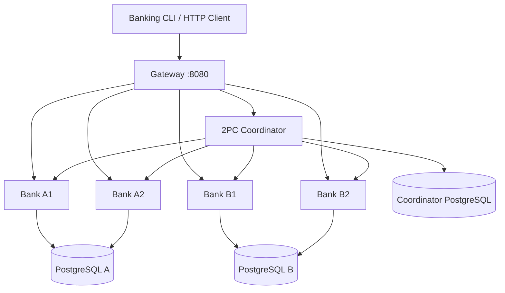

# Distributed Banking Platform — Assignment 2

Python 3.12 / FastAPI / PostgreSQL 16 / real PostgreSQL prepared transactions / Docker Compose.

This implements the **mandatory core** of the university assignment: two authoritative shard databases, four stateless application replicas, a health-aware Round Robin Gateway, ACID local banking operations, a separate durable 2PC Coordinator, replay-safe Phase 2, and crash reconciliation. The two optional expert bonuses are **not implemented** pending approval.

> **Verification disclosure (2026-10-25):** The initial source-generation environment lacked Docker. The student subsequently built and ran the system on an Apple Silicon Mac (Docker 29.1.3 / Compose 2.40.3) and supplied actual terminal transcripts: all seven required experiments passed, as did five protocol tests, Coordinator crash recovery at both injection points, participant-outage recovery and a PostgreSQL volume-persistence restart test. The ten non-disruptive integration tests were rerun together: **10 passed in 2.96s with no pytest cache warnings**. All seven app/test Image builds and recreation of the six running app containers then succeeded; CLI smoke (balance, deposit, withdraw, cross-shard transfer and both status-lookup modes) and four unit tests passed on those rebuilt images. Finally, **all seven experiments, the five protocol tests, and participant-outage recovery passed again on the rebuilt containers**, which remained healthy. This evidence is recorded in `results/MAC_VALIDATION_2026-10-25.md`. GitHub/Docker Hub publishing and the optional bonuses are not yet completed.

## Topology



Account ownership (configurable in `config/shards.json`):

| Owner | Accounts | Replicas | Authoritative DB |
| --- | --- | --- | --- |
| A | A0001–A1000 | A1 and A2 | db-a |
| B | A1001–A2000 | B1 and B2 | db-b |

At first start, every account is seeded with an initial balance of `1000.00`. A replica skips the bulk seed when the entire shard's account range already exists; otherwise the seed uses `ON CONFLICT DO NOTHING`. This restart guard is important because PostgreSQL prepared transactions can hold row locks that would otherwise block a redundant bulk seed. Subsequent restarts never overwrite existing balances. Production financial data needs stronger identity, security, audit and compliance controls; see `docs/ARCHITECTURE.md`.

## Prerequisites and first start

- Docker Engine with Docker Compose V2 (`docker compose version`).
- Python 3.12 for the host-side scripts; PostgreSQL and web Python dependencies run in containers.
- Sufficient RAM for three PostgreSQL servers, four bank replicas, Gateway and Coordinator.

```bash
cp .env.example .env
# Edit POSTGRES_PASSWORD and INTERNAL_TOKEN in .env. Use URL-safe characters.
docker compose config --quiet
docker compose build
docker compose up -d
docker compose ps
curl -fsS http://localhost:8080/health
curl -fsS http://localhost:8080/routing
```

**Network-constrained builds:** If `pypi.org` times out but the USTC mirror is reachable from Docker, build with `docker compose build --build-arg "PIP_INDEX_URL=https://mirrors.ustc.edu.cn/pypi/simple"`. Then use `docker compose up -d --no-build` to reuse the already-built images. On macOS, Docker Desktop must have access to the project's parent folder if PostgreSQL initialization SQL files are bind-mounted from `Documents`.

Do not use `docker compose down -v` unless explicitly intending to **delete all accounts and transaction journals**. `docker compose down` (without `-v`) and `docker compose up -d` preserve named volumes.

The exposed public API is bound to `127.0.0.1:8080`. PostgreSQL and Coordinator ports are not published to the host. In a remote VM, use an SSH tunnel or an authenticated reverse proxy.

## Client and API examples

From host, either install `requirements.txt` or use `curl` (the client depends on `httpx`):

```bash
python3 -m pip install -r requirements.txt
python3 -m app.client balance A0500
python3 -m app.client deposit A0500 10.25
python3 -m app.client withdraw A0500 5.00
python3 -m app.client transfer A0500 A0600 15.00
python3 -m app.client transfer A0500 A1500 25.00
# Keep the printed request_id and tx_id for uncertainty/retries.
python3 -m app.client status <tx_id>
python3 -m app.client request <request_id>
```

Or call the public Gateway with explicit idempotency key:

```bash
curl -sS -X POST http://localhost:8080/transfers \
  -H 'Content-Type: application/json' \
  -d '{"from_account":"A0500","to_account":"A1500","amount":"25.00","request_id":"d425d679-c8a7-4abe-b82f-40cd66d5a3fa"}'
curl -sS http://localhost:8080/requests/d425d679-c8a7-4abe-b82f-40cd66d5a3fa
```

Every write **requires** a client-generated UUID `request_id`; the CLI generates one automatically. Reusing the exact request ID and payload is safe; changing the payload with the same request ID returns HTTP 409. **If Gateway times out, do not generate a fresh ID until the original outcome is known.** Cross-shard `PENDING` (HTTP 202) means there is no definitive client success yet. Poll the transaction/request status endpoint.

An accepted/committed transfer returns HTTP 200 with `status=COMMITTED`; a durably aborted transfer returns HTTP 409 with `status=ABORTED`; an unresolved transfer returns HTTP 202 with `status=PENDING`.

API reference: `http://localhost:8080/docs` (OpenAPI UI). Monetary inputs must be strings with at most two fractional digits, e.g. `"12.50"` rather than JSON floats.

## Core behavior and consistency

- Local deposit, withdrawal and same-shard transfer run in one PostgreSQL transaction using row locks (`FOR UPDATE`) and unique idempotency receipts. Negative balances are rejected.
- Gateway checks `/health` every second and chooses Round Robin among healthy replicas of the **owning shard only**. Transport/5xx errors cause replica exclusion and safe retry of the identical request.
- Cross-shard 2PC calls `PREPARE TRANSACTION` on both shard databases, durably stores `COMMIT_DECIDED` or `ABORT_DECIDED` before sending Phase 2, and records each participant acknowledgement separately. A COMMIT is never reversed to ABORT after being decided.
- Every participant's committed effect is guarded by a durable `transfer_receipts` row inside its prepared transaction. Duplicate `COMMIT` and `ABORT` messages are safe. ABORT writes a durable tombstone before acknowledging, fencing a late `PREPARE`.
- The Coordinator reconciliation thread scans durable unfinished records on startup and every two seconds. Undecided transactions are aborted; decided transactions are retried. A transaction is `COMPLETED` only after acknowledgement from **both** shards.

Full protocol, expected guarantees and known limitations: `docs/ARCHITECTURE.md`.

## Tests and seven required experiments

**Static/unit checks**, which can run without Docker:

```bash
python3 -m compileall -q app tests scripts
python3 -m unittest discover -s tests/unit -v
python3 -c 'import yaml; c=yaml.safe_load(open("docker-compose.yml")); assert len(c["services"]) == 10'
```

**Integration suite** after `docker compose up -d`:

```bash
docker compose --profile test run --rm -T test-runner pytest -s -v tests/integration
```

**Required experiment scripts**:

| PDF §6 | Verification | Command |
| --- | --- | --- |
| 1 — Shard distribution | Separate DB ownership and correct Gateway route | `bash scripts/experiment_1.sh` |
| 2 — Replica load balance | Both replicas observed for each shard | `bash scripts/experiment_2.sh` |
| 3 — Concurrent replica ops | 40 concurrent deposit/withdraw, exact final balance | `bash scripts/experiment_3.sh` |
| 4 — Replica stop under load | Stop A1 while requests continue through A2 | `bash scripts/experiment_4.sh` |
| 5 — Local vs cross-shard transfers | ACID + confirmed 2PC receipts/ACKs | `bash scripts/experiment_5.sh` |
| 6 — Coordinator crash/recovery | Hard crash at PREPARED and COMMIT_DECIDED | `bash scripts/experiment_6.sh` |
| 7 — Overlapping cross-shard concurrency | Resolve all transfers and conserve total money | `bash scripts/experiment_7.sh` |

For tests 1,2,3,5,7 the full command format is:

```bash
docker compose --profile test run --rm -T test-runner pytest -s -v \
  tests/integration/test_experiments.py -k experiment_7
```

Execute all seven and additional duplicate-operation, participant-vote and insufficient-funds tests using:

```bash
bash scripts/run_all_experiments.sh
```

Additional participant network outage with a **durable COMMIT** (Coordinator remains `PENDING` while both B replicas are stopped):

```bash
bash scripts/experiment_participant_disconnect.sh
```

The outage script starts the Coordinator using `docker compose up -d --no-deps --no-build coordinator`, deliberately keeping the failed shard offline until the pending COMMIT has been observed. Do not replace this command with `docker compose start coordinator`: the latter may start health-gated dependencies and invalidate the outage scenario.

Fault injection must be explicitly enabled (`ENABLE_FAULT_INJECTION=true` in `.env`; disabled by default in Compose). Disable it for ordinary non-test deployments.

Tests modify seeded account balances intentionally, but are designed to be rerunnable without resetting the databases. Use a fresh disposable deployment for recorded demo results.

## SQL inspection and operational troubleshooting

```bash
docker compose exec db-a psql -U banking -d banking -c \
  "SELECT account_id,balance FROM accounts WHERE account_id IN ('A0500','A0600');"
docker compose exec db-b psql -U banking -d banking -c \
  "SELECT account_id,balance FROM accounts WHERE account_id='A1500';"
docker compose exec db-a psql -U banking -d banking -c \
  "SELECT gid,prepared FROM pg_prepared_xacts;"
docker compose exec db-coordinator psql -U banking -d banking -c \
  "SELECT tx_id,state,decision,acknowledgements FROM distributed_transfers ORDER BY created_at DESC LIMIT 10;"
docker compose logs --tail=150 gateway coordinator bank-a1 bank-a2 bank-b1 bank-b2
```

If a replica is marked down: check `docker compose ps`, `/routing`, and the replica logs; let the health monitor rediscover it. If a transfer remains `PENDING`, check Coordinator logs, health of both shard DBs, `pg_prepared_xacts`, then restart the Coordinator **without deleting its DB volume**. Never manually roll back a prepared transaction if a durable COMMIT decision may exist.

Prepared transactions are intentionally blocking while the Coordinator decision is unresolved (classic 2PC limitation). A permanently lost coordinator DB can require administrative recovery; PostgreSQL DB replication/failover is out of scope per PDF.

## Documentation and delivery

- `docs/REQUIREMENTS.md` — section-by-section acceptance matrix and verification status.
- `docs/ARCHITECTURE.md` — design details, architecture and 2PC sequence diagrams.
- `docs/DEMO.md` — ≤15-minute recording script with commands.
- `docs/PUBLISH.md` — GitHub and Docker Hub publication procedure.
- `output/pdf/Technical_Report.pdf` — ≤10-page A4 technical report with the observed Mac test results and fault-analysis note.
- `results/MAC_VALIDATION_2026-10-25.md` — actual results transcribed from the student's terminal, including recovery diagnostics and unresolved deliverables.
- `docs/FINAL_CHECKLIST_FA.md` — Persian final validation and handoff checklist.
- `scripts/publish_images.sh` — explicit Docker Hub publish command (requires your credentials).

No optional re-sharding or custom container self-healing implementation has been started. A scoped proposal is included in `docs/BONUS_PLAN.md`; approval is required before implementation.

