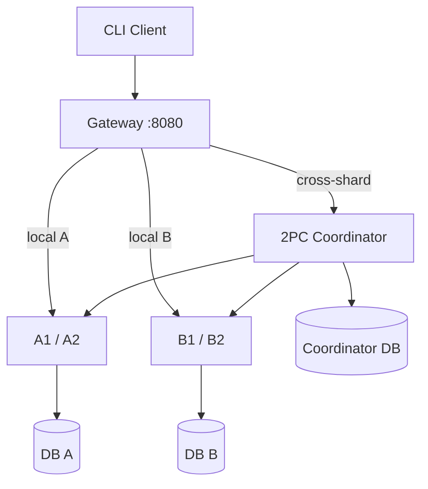
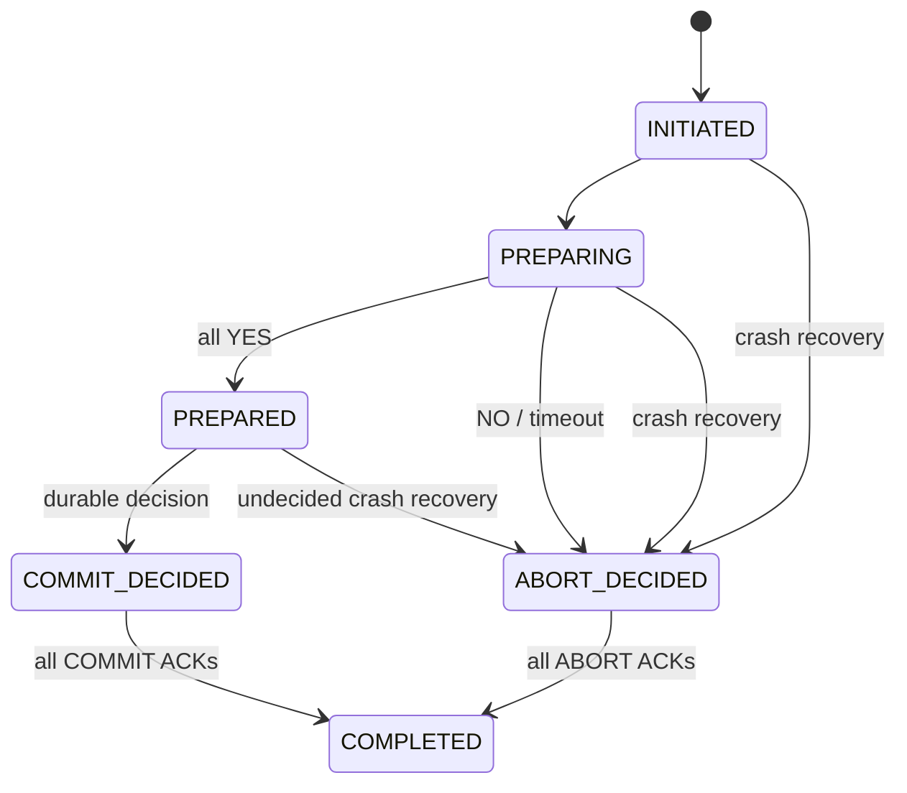

# Architecture, failure model and 2PC protocol

## Overview



The boxes `A1 / A2` and `B1 / B2` represent two distinct stateless FastAPI processes per shard, not database replicas. `config/shards.json` owns exclusive account ranges. The Gateway validates ownership and forwards only to healthy replicas belonging to that same shard. A second ownership check at each shard's write path rejects misrouted traffic.

## Data and local ACID operations

`db/shard.sql` defines `accounts` (exact `NUMERIC(20,2)`, nonnegative check), `operation_receipts`, `transfer_receipts`, and `participant_journal`. Application replicas share exactly one DB per shard, and no application instance holds authoritative in-memory balances.

`app/shard.py` uses database transactions, a unique receipt keyed by caller-provided UUID and row locks ordered by account ID. Duplicated requests either wait on the first receipt or return the stored prior result. A reused ID with different parameters returns a conflict. Timeouts/lock contention fail safely without partial updates, and callers retry with the **same** ID. Same-shard transfer changes both balances in one local transaction.

## Health-aware replica selection

`app/routing.py` probes every configured replica each second and verifies that `/health` returns the expected shard name. Per-shard locked counters choose Round Robin. Failed transport/HTTP 5xx calls mark the chosen replica unhealthy; identical calls can be retried against another replica. Business 4xx responses are not retried. All writes carry idempotency IDs, making an ambiguous network reply safe to repeat.

## Actual PostgreSQL 2PC

```mermaid
sequenceDiagram
    participant Client
    participant Gateway
    participant Coordinator
    participant DBc as Coordinator DB
    participant A as Shard A / PG A
    participant B as Shard B / PG B
    Client->>Gateway: POST transfer + request_id
    Gateway->>Coordinator: Cross-shard transfer
    Coordinator->>DBc: INSERT INITIATED, PREPARING
    Coordinator->>A: PREPARE(tx_id, DEBIT)
    A->>A: UPDATE + receipt; PREPARE TRANSACTION
    A-->>Coordinator: YES
    Coordinator->>B: PREPARE(tx_id, CREDIT)
    B->>B: UPDATE + receipt; PREPARE TRANSACTION
    B-->>Coordinator: YES
    Coordinator->>DBc: PREPARED, COMMIT_DECIDED (durable)
    Coordinator->>A: COMMIT(tx_id)
    A->>A: COMMIT PREPARED
    A-->>Coordinator: ACK
    Coordinator->>DBc: Persist ACK A
    Coordinator->>B: COMMIT(tx_id)
    B->>B: COMMIT PREPARED
    B-->>Coordinator: ACK
    Coordinator->>DBc: Persist ACK B, COMPLETED
    Coordinator-->>Gateway: COMMITTED
    Gateway-->>Client: COMMITTED
```

If a participant votes NO or times out, the Coordinator logs `ABORT_DECIDED` before sending ABORT to **both** participants. A participant records an `ABORTING` tombstone before `ROLLBACK PREPARED`, then `ABORTED`, so a late PREPARE cannot resurrect the transfer. On COMMIT, `transfer_receipts` is part of the prepared database transaction: it proves the balance effect is already committed, even if the application crashed before recording its out-of-band journal state. Duplicate COMMIT/ABORT requests do not reapply money movements.

## Recovery state machine



- Coordinator state, reason, decision, and per-participant ACK map are stored in DB C (`db/coordinator.sql`). Every state change is a separate committed database operation before network messages are sent.
- On startup and every two seconds, `recover_once()` scans unresolved IDs. A session advisory lock excludes active in-process transfers and other recovery attempts.
- An unresolved record **without** a durable decision becomes `ABORT_DECIDED`; a **COMMIT_DECIDED** record is never changed to ABORT. Retries continue until both participants confirm. A transient failure remains externally `PENDING` (HTTP 202 from the initial transfer), never prematurely `COMMITTED`.
- Each participant also serializes 2PC messages for the same transaction ID across its replicas using a database session advisory lock. This prevents PREPARE/ABORT races and duplicate effects.
- After a successful PREPARE, PostgreSQL holds row locks and the provisional balance/receipt in a durable prepared transaction, discoverable from `pg_prepared_xacts`. The participant journal is supplementary; if its update is interrupted, `pg_prepared_xacts` and the in-transaction receipt allow safe inference on retried messages.

## Failure scenarios and acceptance commands

| Fault | Expected outcome | Implemented test |
| --- | --- | --- |
| First shard YES, second NO | Durable ABORT; both participants rolled back/fenced | `test_prepared_participant_and_second_vote_no` |
| Coordinator dies with both prepared, no decision | Recovery chooses durable ABORT, rolls back both | `experiment_6.sh` (`after_prepare`) |
| Coordinator dies after durable COMMIT | Recovery preserves COMMIT, eventually gets both ACKs | `experiment_6.sh` (`after_commit_decision`) |
| Participant unreachable after durable COMMIT | Report PENDING; retry COMMIT after it returns | `experiment_participant_disconnect.sh` |
| Duplicate COMMIT or ABORT | Same final result, no extra debit/credit | `test_duplicate_commit_messages`, `test_prepared_participant_and_second_vote_no` |
| Two replicas concurrently update one account | Row locks and idempotency protect exact balances | `test_experiment_3_concurrent_deposits_withdrawals` |
| Overlapping cross-shard transfers | Every transfer resolves; overall money conserved | `test_experiment_7_overlapping_concurrent_distributed_transfers` |

## Honest limitations

1. Classic blocking 2PC: an unresolved prepared transaction locks participating rows while the Coordinator decision cannot be recovered. The Coordinator database is not HA; this is within the PDF's non-required DB failover scope.
2. Shard map is static for the mandatory core, and the full live-migration epoch/fencing work is **bonus I**, explicitly not implemented.
3. Replica detection and failover exist, but automated replacement-container creation is **bonus II**, explicitly not implemented. No custom self-healing controller is claimed.
4. Only two decimal places and one currency are supported. No authentication for public end users, TLS termination, audit/account ownership verification, rate limiting, or enterprise compliance framework is included; this is educational software.
5. Recovery depends on access to the participant DBs and the Coordinator DB volume. Loss of the latter makes automatic reconstruction of the global decision impossible without external backups.
6. There is no full Docker-based runtime verification in the original generation environment; run the supplied integration/fault scripts on a Docker host before submission.

